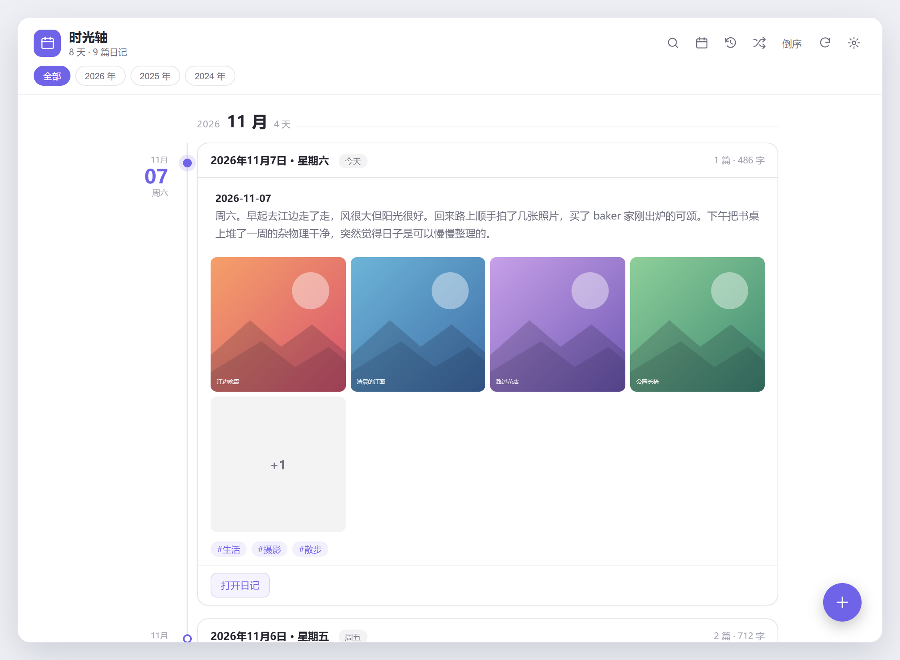
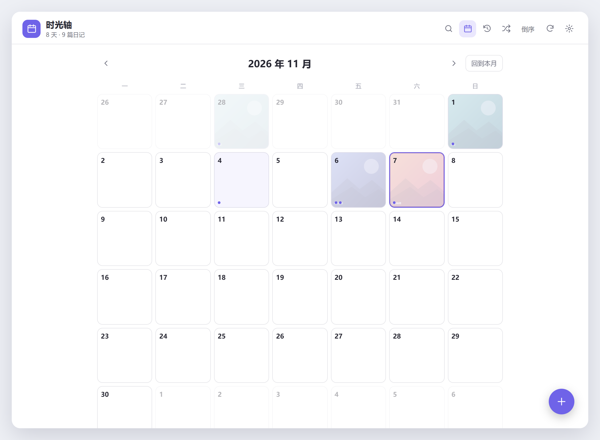
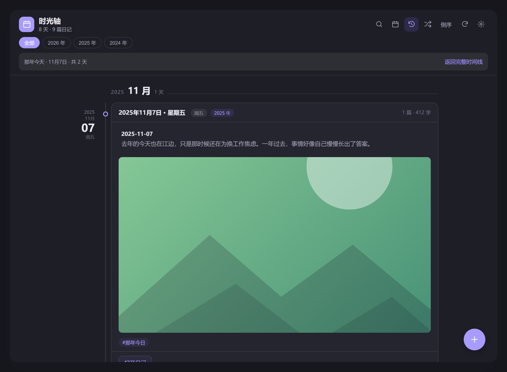
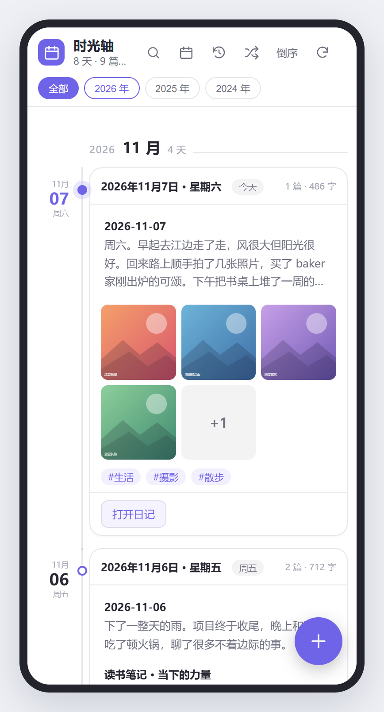
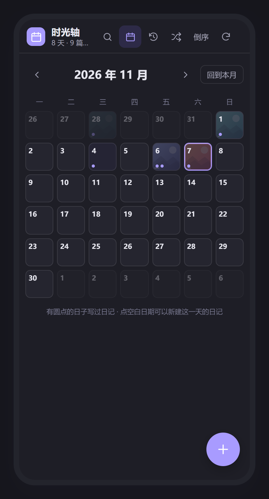

# 日记时间线 · Day Timeline

[](https://obsidian.md) 

一个展示日记时间线的 Obsidian 插件：把日记按**一天**为单位聚合成一条可以一直往下滑的时光轴，左侧日期轴、右侧图文卡片，并配上日历速览与「那年今天」。

纯本地读写、不联网；`manifest.json` 已声明 `isDesktopOnly: false`，**桌面端和手机端都能用**。



> 下方所有截图来自仓库内的 `preview.html` 预览页，使用示例日记数据；预览页与插件共用同一份 `styles.css`，因此显示效果与插件内一致。

---

## 界面预览

| 日历视图 · 按日速览 | 那年今天 · 深色主题 |
| --- | --- |
|  |  |

| 手机端时间线 | 手机端日历（深色） |
| --- | --- |
|  |  |

截图源文件都在 [`screenshots/`](screenshots/) 目录，使用相对路径引用，上传到 GitHub 后可直接显示。

---

## 功能

| 功能 | 说明 |
| --- | --- |
| 按天聚合 | 同一天的多篇日记合成一个时间线节点，显示篇数、字数、摘要 |
| 图文混排 | 自动提取 `![[图片.png]]` 与 ``，生成缩略图网格 |
| 时间轴视觉 | 月份分隔、竖向轴线与圆点、今天高亮、年份 chips 快速筛选 |
| 搜索 / 排序 | 标题、正文、标签、路径全文过滤；正序 / 倒序一键切换 |
| 日历视图 | 有日记的日期显示圆点和图片底色，点击回到那一天的日记；点空白日期可新建该日日记 |
| 那年今天 | 一键回看往年同一个月日写下的记录 |
| 随机回顾 | 顶栏随机按钮 / 命令面板，从当前筛选结果（或全库）随机打开一篇日记 |
| 写日记 | 右下角「+」或命令面板，按配置的日期格式创建并打开；日历里点空白日期可新建该日日记 |
| 移动端 | 窄屏紧凑布局、36px 以上触摸目标、底部安全区适配、每次加载天数自动减半 |
| 自动刷新 | 笔记增删改与设置变化后自动重建索引（编辑时延迟 1.5 秒，避免打字卡顿） |

---

## 安装

### 方式一 · BRAT（自动更新，适合长期用）

[BRAT](https://github.com/TfTHacker/obsidian42-brat) 是 Obsidian 社区插件市场里的工具，可以直接从 GitHub 仓库安装并自动更新尚未上架官方市场的插件。

1. 设置 → 第三方插件 → 浏览，搜索安装 **BRAT** 并启用。
2. 打开 BRAT 设置，点击 **Add Beta Plugin**（或命令面板搜索 `Add a beta plugin for testing`）。
3. 填入仓库地址 `https://github.com/fc8/obsidian-day-timeline`，版本选 `Latest version` 并确认。
4. 回到「设置 → 第三方插件」确认「日记时间线 Day Timeline」已启用（BRAT 通常会自动启用）。
5. 以后更新：在 BRAT 设置里点 **Check for updates**，或命令面板搜索 `Check for updates to all beta plugins`。

### 方式二 · 手动下载（最快，不需要额外插件）

下载仓库根目录的 [`life-timeline.zip`](life-timeline.zip)，解压出 `life-timeline/` 文件夹，整个放进 Obsidian 仓库的 `.obsidian/plugins/` 下。

### 方式三 · 从源码复制

把仓库里的 [`dist/life-timeline/`](dist/life-timeline/) 文件夹复制到 `.obsidian/plugins/life-timeline/`，或者手动新建该目录并放入根目录的 `manifest.json`、`main.js`、`styles.css` 这三个文件。

手动安装完成后，重启 Obsidian → 设置 → 第三方插件 → 启用「日记时间线 Day Timeline」；BRAT 安装通常会自动加载并启用，无需重启。

**手机 / 平板端**

1. 先在电脑端装好并启用一次。
2. 用你常用的同步方案（Remotely Save、Syncthing、iCloud、OneDrive、Git 等）把整个 `.obsidian/plugins/life-timeline/` 文件夹同步到手机仓库。
3. 手机端 Obsidian → 设置 → 第三方插件 → 启用。插件不使用任何 Node / Electron / 文件系统 API，全部走 Obsidian 跨端 API，因此可以直接在 iOS / Android 上运行。

> 两端都要各自启用一次第三方插件；`data.json`（设置）可以不参与同步，各设备独立保存。

---

## 日记怎么放

默认**跟随核心插件「日记」**的文件夹与日期格式；如果没有配置，就在「设置 → 日记时间线」里手动指定。

日期识别优先级：

1. frontmatter 字段（`date`、`created`、`日期`，可在设置里改）
2. 文件名里的日期：`2026-11-07`、`2026.11.7`、`2026年11月7日`、`20261107` 都能识别
3. 可选：文件创建时间（开关「按文件创建日期兜底」）

图片直接写 Obsidian 双链或标准 Markdown 即可，插件会通过库内链接解析出真实附件，手机上也能正常显示：

```markdown
---
date: 2026-11-07
tags: [生活, 摄影]
---

今天去了江边，风很大，拍到了很好看的晚霞。

![[attachments/晚霞.jpg]]
```

---

## 使用

命令面板（Ctrl/Cmd + P）里有 5 个命令：

- `日记时间线: 打开日记时间线`
- `日记时间线: 打开日记日历`
- `日记时间线: 那年今天`
- `日记时间线: 写今天的日记`
- `日记时间线: 随机打开一篇日记`

视图顶栏从左到右：搜索、日历、那年今天、随机、排序、刷新、插件设置（窄屏下可横向滑动）。随机按钮会遵循当前筛选（例如在「那年今天」里只抽往年同一天），命令面板里的随机命令则从全部日记中抽取。点击任意日记条目或图片会在**新标签页**打开笔记，时间线本身不会被替换。滚动到底部自动加载更多天。

---

## 主要设置

| 设置 | 默认值 | 说明 |
| --- | --- | --- |
| 跟随 Obsidian「日记」设置 | 开 | 自动读取核心插件的文件夹与格式 |
| 日记文件夹 / 文件名日期格式 | 空 / `YYYY-MM-DD` | 自定义来源与新建日记的文件名 |
| 日期字段 / 排除文件夹 | `date, created, 日期` / 模板目录 | 控制哪些笔记进入时间线 |
| 摘要字数 / 每天最多图片 | 180 / 4 | 卡片密度 |
| 每次加载天数 | 30 | 手机端自动取 min(设置值, 20) |
| 新建日记默认内容 | 空 | 支持 `{{date}}`、`{{date:YYYY年M月D日 dddd}}`、`\n` |

---

## 开发 / 构建

```bash
npm install
npm run dev        # 监听改动，生成带 sourcemap 的 main.js
npm run build      # 类型检查 + 压缩打包 + 同步样式到预览页
npm run typecheck  # 只做类型检查
npm test           # 数据层测试：日期识别 / 图片与摘要 / 按天聚合 / 新建路径
```

源码在 `src/`：`main.ts`（插件入口 / 命令 / 新建日记）、`data.ts`（扫描、日期解析、图片与摘要提取）、`view.ts`（时间线 / 日历 / 那年今天视图）、`settings.ts`（设置面板）、`utils.ts`（日期与 DOM 工具）。

`preview.html` 是不需要安装 Obsidian 就能看的交互预览（可直接用浏览器打开，也可用 GitHub Pages 托管）。若修改了界面想重新生成上面的截图：

```bash
npm install --no-save puppeteer-core   # 需要本机 Chrome 或 Edge
node scripts/capture-screenshots.mjs
```

---

## 已知限制

- 首次打开会扫描仓库内全部 Markdown 并读取内容建立索引，几千篇日记大约需要 1–2 秒；之后按批渲染，不会一次性生成几千个 DOM 节点。
- 缩略图使用原图（仅 CSS 裁切），如果日记里嵌入了大量高分辨率照片，可调小「每天最多显示图片」或关闭「显示图片」。
- 只识别图片，不解析视频 / 录音；这些会以正文文字形式保留在摘要里。
- 日期以本地时区的「年月日」为准，不处理带时区的时间戳偏移。
